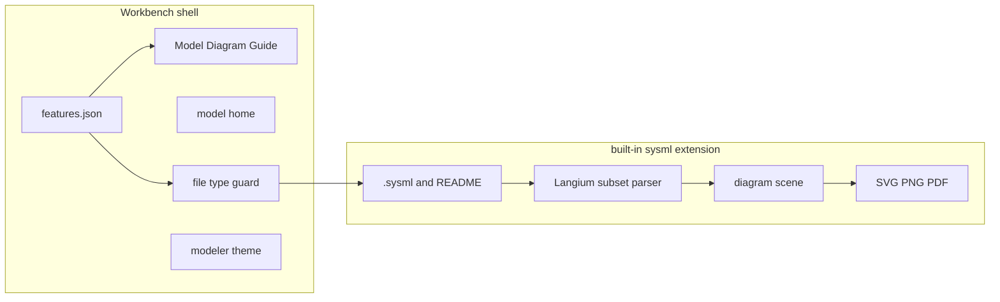
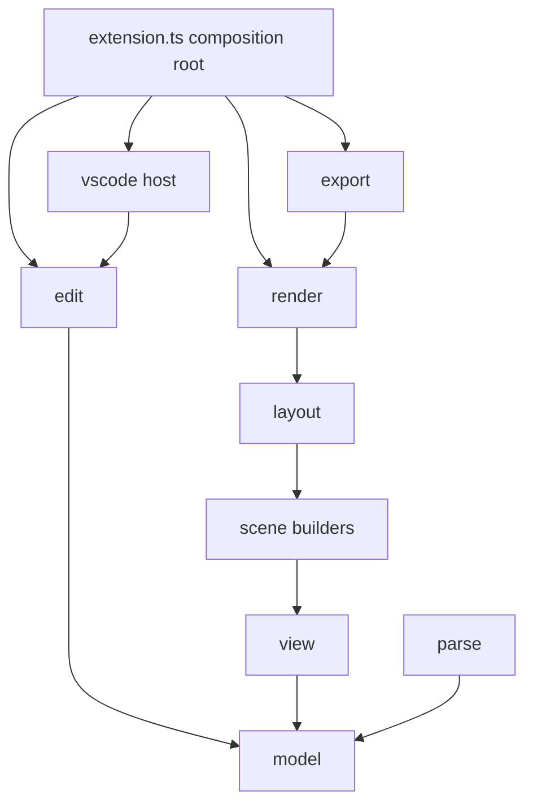

# SysML Diagram Modeler

Build **SysML Diagram Modeler** as a branded Code-OSS product whose workbench is a modeling tool. The app opens **SysML** (`.sysml`, `.kerml`) and **README** (`README`, `README.md`) files. Everything else in the stock editor — debug, terminal, git, extensions, remote, notebooks, other languages — is switched off in the product, and the chrome is redesigned around model, diagram, and guide.

Diagram rendering, export, and write-back still live in one built-in extension. The fork is what makes the shell feel like its own IDE: branding, a feature manifest, workbench layout, and theme. Day-to-day diagram work can still run the extension with F5; the shell polish shows up in the product build.

The workspace at [sysml-diagram-modeler](/Users/shivankarsharma/newcastle_ms/sysml-diagram-modeler) is empty, so this plan is the initial repo shape.

## What the app is

A session looks like this:

- Left rail has three destinations: **Model** (explorer of SysML files), **Diagram** (the open view), **Guide** (the project README, rendered).
- Opening a `.sysml` file splits the text editor and the diagram. Opening a README fills the editor with Markdown preview and hides the diagram.
- The menu bar is File, Model, Diagram, Help. The status bar is one quiet line: file, view kind, validation, export.
- Home is recent models and New model, plus the sample README. The VS Code welcome, account menu, and extension marketplace are absent.

## Feature switches

[ide/features.json](ide/features.json) is the list of product capabilities. Bootstrap and a small workbench patch read it. Turning a capability off removes its views, commands, and built-in extension from the build. Users do not get a VS Code settings page full of unrelated toggles.

On:

- Explorer, restricted to `*.sysml`, `*.kerml`, `README`, `README.md`
- Text editor for those files, Markdown preview for README
- Diagram panel, model outline, export, the reduced command palette
- Modeler settings (view kind, layout, experimental canvas)

Off:

- Debug and Run
- Terminal and tasks
- Source control, Git, and GitHub
- Extensions view and the marketplace
- Remote, accounts, profiles, tunnels
- Notebooks, testing, and every built-in language except Markdown
- Find across the disk stays available, scoped to SysML and README

`.sysmlview.json` layout sidecars stay hidden from the explorer. They are editor state, not a third user-facing file type.

Opening any other file shows a single empty editor: “SysML Diagram Modeler edits SysML models and README files.” The file is not handed to a random language mode.

## Visual design

One workbench theme, shipped as a built-in, applied by default.

- Dark graphite surfaces, hairline borders, one accent (blueprint blue) used only for selection, ports, and the active rail item.
- UI font is the platform UI font. SysML source uses a standard mono. Diagram labels use the UI font at a smaller size.
- The activity bar of many colored extension icons is replaced by the three-item rail. Icons are simple strokes, one size.
- Diagram canvas is a flat field with a faint grid. Symbols are outlined, with compartment text, close to the SysML graphical notation.
- Motion is limited to hover and selection. No gradient hero, no glass panels.

Patches live in [ide/patches/](ide/patches/) and are tagged in source so a rebase onto a new Code-OSS tag stays reviewable. Expected patches: default layout and title, activity-bar contents driven by `features.json`, the file-type guard, and the home view. Color and typography stay in the theme extension so they do not require a workbench rebuild to tweak.

## Product build

- Pin a `microsoft/vscode` release tag. Do not commit the upstream tree. [ide/scripts/bootstrap.mjs](ide/scripts/bootstrap.mjs) clones that tag, deep-merges [ide/product.overlay.json](ide/product.overlay.json), applies [ide/patches/](ide/patches/), and copies the extension in as a built-in.
- `configurationDefaults` in the overlay set the theme, the rail layout, `files.exclude`, and editor associations.
- Bootstrap skips stock built-ins listed as off in `features.json` (git, github, merge-conflict, debug helpers, emmet, language packs other than markdown).
- Gallery, if any URL remains, points at Open VSX. The extensions view itself is off, so the gallery is unused in the product. Name, `applicationName`, data folder, and URL protocol are `sysml-diagram-modeler`, so it can sit beside VS Code.
- Product icon, title, and about dialog use our name. The VS Code name and logo stay out of the build.

## Language, diagrams, and edits

SysML v2 text is the source of truth. The first parser is a Langium subset, with fixtures from public pilot examples.

Subset:

- `package`, `part def`, `part`, `port`, `connect` / `interface`, `action`, `succession`, `state`, `transition`
- `view`, `view def`, `expose`, `filter`, `render` for `GeneralView`, `InterconnectionView`, `ActionFlowView`, `StateTransitionView`
- Qualified names and a workspace index so `expose` can see other `.sysml` files

Each symbol keeps its document URI and source range for click-to-source and write-back. Standard-library names (`Views::asTreeDiagram`, `StandardViewDefinitions::*`) are stubbed locally until the OMG library license is checked.

**SysML v1 later:** diagrams consume a `ModelSnapshot`. The v2 parser is the only producer for now. A future XMI importer is another producer. No EMF runtime in the first build.

Diagram pipeline:

1. Render the `view` under the cursor, or an implicit interconnection or general view of the current package.
2. Build a scene graph with source ranges.
3. Layout with ELK (layered for flow and state, nested or layered for parts and ports).
4. Draw part, port, action, state, and transition symbols. Pan, zoom, fit, selection.

Order: interconnection, general structure, state transition, action flow. Sequence views wait.

Export from the same SVG: `.svg`, `.png`, `.pdf`. A `view` may set `fileName` and a format hint.

Write-back applies a text edit, then re-parses: rename, add `part` or `port`, add `connect`, add `state` or `transition`.

Experimental canvas behind `sysml.experimental.canvas`: palette and drag-create use those same inserts. Freeform positions live in the hidden `.sysmlview.json` sidecar. A toggle returns the view to ELK.

## Code structure

The extension is a set of small packages. Each file has one reason to change. VS Code types appear only in the composition root and the `vscode/` folder, so parsing, scenes, layout, and export can be tested as plain TypeScript.

Dependency direction is one way, toward `model`. `parse` produces a `ModelSnapshot`. A later SysML v1 importer would be another producer of that same snapshot. Scene builders, the layout engine, and exporters depend on the snapshot and the scene graph, so a new diagram kind or a new export format does not rewrite the pipeline.

Interfaces, one job each:

- `ModelSource` — text documents in, `ModelSnapshot` out
- `ViewResolver` — cursor and snapshot in, the elements and edges to draw out
- `SceneBuilder` — one implementation per view kind (`InterconnectionSceneBuilder`, `GeneralSceneBuilder`, `StateSceneBuilder`, `ActionFlowSceneBuilder`)
- `LayoutEngine` — scene in, positioned scene out. ELK is the first implementation
- `SymbolPainter` — one file per symbol (part, port, action, state, transition)
- `DiagramExporter` — one file per format (`SvgExporter`, `PngExporter`, `PdfExporter`), all taking the same SVG string
- `ModelEdit` — one file per gesture (`renameElement`, `addPart`, `addPort`, `addConnection`, `addState`, `addTransition`). The experimental canvas calls these functions; it does not grow its own text edits

`extension.ts` is the composition root. It constructs the implementations and registers commands. It contains no parsing or SVG logic.

File rules for the whole repo:

- One exported type or one cohesive function group per file. A file that mixes parsing, layout, and webview messages gets split.
- New behavior is a new file that implements an existing interface, registered from the composition root.
- Shared helpers live next to the package that owns them. A function used by both write-back and the canvas lives in `edit/`, and both call it.
- Packages do not import each other sideways. `render` does not import `parse`.
- UI copy, theme tokens, and feature flags are data files, not string literals scattered through commands.

## Repo layout

- [extensions/sysml-modeler/src/extension.ts](extensions/sysml-modeler/src/extension.ts) — composition root only
- [extensions/sysml-modeler/src/vscode/](extensions/sysml-modeler/src/vscode/) — commands, webview host, status bar, file-type messages
- [extensions/sysml-modeler/src/model/](extensions/sysml-modeler/src/model/) — `ModelSnapshot`, source ranges, workspace index
- [extensions/sysml-modeler/src/parse/](extensions/sysml-modeler/src/parse/) — Langium grammar and the mapper to a snapshot
- [extensions/sysml-modeler/src/view/](extensions/sysml-modeler/src/view/) — expose, filter, and render resolution
- [extensions/sysml-modeler/src/scene/](extensions/sysml-modeler/src/scene/) — scene graph types and one builder file per view kind
- [extensions/sysml-modeler/src/layout/](extensions/sysml-modeler/src/layout/) — `LayoutEngine` and the ELK adapter
- [extensions/sysml-modeler/src/render/](extensions/sysml-modeler/src/render/) — SVG document plus one symbol file
- [extensions/sysml-modeler/src/export/](extensions/sysml-modeler/src/export/) — SVG, PNG, and PDF exporters
- [extensions/sysml-modeler/src/edit/](extensions/sysml-modeler/src/edit/) — one text-edit gesture per file
- [extensions/sysml-modeler/src/theme/](extensions/sysml-modeler/src/theme/) — color and type tokens
- Tests sit beside the package they cover (`model/modelSnapshot.test.ts` and so on) and import no `vscode` module
- [ide/features.json](ide/features.json) — capability switches
- [ide/product.overlay.json](ide/product.overlay.json) — name, defaults, gallery
- [ide/patches/](ide/patches/) — rail, file guard, home, menu trim. One patch file per shell change
- [examples/](examples/) — one small model per diagram kind, plus a README that the Guide rail opens
- [docs/v1-import.md](docs/v1-import.md) — `ModelSnapshot` and a later v1 mapping

## Milestones

1. Package folders, interfaces, and the composition root exist. The extension loads on `.sysml` and renders one fixed interconnection fixture to SVG through `SceneBuilder`, `LayoutEngine`, and `SvgExporter`.
2. Product bootstrap with `features.json`, unused built-ins removed, and the file-type guard. A dev build opens only SysML and README.
3. Shell polish: three-item rail, trimmed menus, model home, theme, status bar. Check the layout against a sample model and its README.
4. Parser, workspace index, interconnection and general views, click-to-source, SVG and PNG export.
5. State and action-flow views, PDF export.
6. Rename, add part, add connection write-back.
7. Experimental canvas, sidecar layout, palette create.
8. Written v1 import boundary only.

## Risks

- Langium will reject legal SysML outside the subset. Diagnostics name the construct as unsupported, and fixtures record what we accept.
- ELK will differ from Cameo or Syside. The bar is a readable notation that round-trips through text.
- Workbench patches drift when the pinned Code-OSS tag moves. Keep each patch small and tagged.
- A full Electron build is heavy. Use it to verify the shell; keep parser and diagram work on the extension host until a shell change needs a rebuild.
- A module that starts importing `vscode` or reaching into another package's internals gets split before the next feature lands on it.
